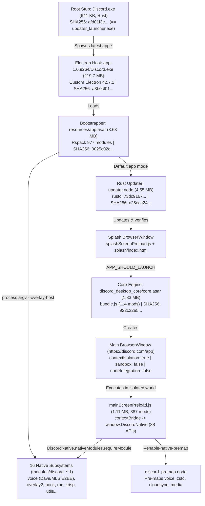

# Discord Desktop (`app-1.0.9264`) — End-to-End Reverse Engineering & Architecture Analysis (REA v6.7.0)

> [!IMPORTANT]
> Deterministic static & metadata reverse-engineering report of **Discord Desktop for Windows (`app-1.0.9264`, Custom Electron `42.7.1`)** produced with **REA (`rea-agents` v6.7.0, Skill v42)**. Every observation is anchored to cryptographic SHA-256 digests and REA `evidence_id` records.

---

## Repository Structure

- [`docs/01-native-and-packaging.md`](./docs/01-native-and-packaging.md) — **Native Binaries, Packaging, Electron Fuses, `.NET/WinMD` & Rust Toolchain Analysis**
- [`docs/02-asar-and-electron-core.md`](./docs/02-asar-and-electron-core.md) — **Bootstrapper (`resources/app.asar`), Core Engine (`core.asar`), `DiscordNative` Preload & Security Boundaries**
- [`docs/03-subsystems-and-modules.md`](./docs/03-subsystems-and-modules.md) — **16 Native Subsystems (`discord_voice`, `discord_overlay2`, `discord_rpc`, `discord_hook`, `discord_krisp`, `discord_utils`, etc.)**

---

## 1. End-to-End Architecture & Boot Flow

---

## 2. Executive Findings Summary

### 2.1 Custom Electron `42.7.1` Host & Electron Fuses (`ev_878d604f...`)
- **Electron Fuses (`app-1.0.9264\Discord.exe` at offset `0x0ADB4AF0`)**:
  - **Disabled (`0`)**: `RunAsNode` (`ELECTRON_RUN_AS_NODE` ignored), `EnableCookieEncryption`, `EnableNodeCliInspectArguments` (`--inspect` ignored), `EnableEmbeddedAsarIntegrityValidation`, `OnlyLoadAppFromAsar`, `LoadBrowserProcessSpecificV8Snapshot`.
  - **Enabled (`1`)**: `EnableNodeOptionsEnvironmentVariable` (`NODE_OPTIONS` honored), `GrantFileProtocolExtraPrivileges`, `WasmTrapHandlers`.
- **Custom Electron Fork Extensions**:
  - Exposes custom C++ binding `electron.discord?.install("createDiscordStream")` in `mainScreenPreload.js` (`6415`) and `--enable-node-leakage-in-renderers`.
  - Embeds custom Crashpad minidump stream `0xd15c0d01` (`DISCORD_CODE_INTEGRITY`, 76-byte struct) parsed by `app.asar` (`55264`) to tag Sentry crash dumps with `code_integrity: "clean" | "modified"`.

### 2.2 Dual Updater Transition & Shared Rust Toolchain
- **Root Launcher Replacement**: Root `C:\Users\brkN\AppData\Local\Discord\Discord.exe` (`641,976` B) is **byte-for-byte identical** (`afd01f3e...`) to `app-1.0.9264\updater_launcher.exe` (enforced on first run by `app.asar` module `62338`).
- **Legacy Squirrel `.NET` Coexistence**: Root `Update.exe` (`1.59` MB, `0a166a5d...`) remains a 32-bit `.NETFramework v4.5` assembly (`Squirrel.Update.Program` v1.1.1.0, `1,457` `TypeDef`s, `10,658` `MethodDef`s) merged via **ILRepack** (`ILRepack.List`).
- **Unified Rust Compiler (`rustc 73dc9167f1cd099e525c9ade2e068d1907b78564`)**: Identified across `updater.node`, `updater_launcher.exe`, `Discord.exe` (root), `discord_dispatch.node`, `discord_cloudsync.node`, and `discord_voice.node`.

### 2.3 Defense-in-Depth Renderer & Preload Hardening (`core.asar` & Subsystems)
- **Strict ContextBridge Allowlisting (`mainScreenPreload.js`)**:
  - `DiscordNative.nativeModules.requireModule(name)` only permits `/^discord_[a-z0-9_-]+$/` or `"erlpack"` and blocks `discord_premap`.
  - `DiscordNative.ipc.send` is restricted to `30` allowlisted channels; `DiscordNative.ipc.invoke` is restricted to `14` allowlisted channels.
  - `DiscordNative.settings.set` only allows `20` safe keys (`RENDERER_SET_ALLOWLIST`), blocking renderer writes to `WEBAPP_ENDPOINT`, `DANGEROUS_ENABLE_DEVTOOLS_ONLY_ENABLE_IF_YOU_KNOW_WHAT_YOURE_DOING`, and `ENABLE_STAFF_DEV_TOOLS_BUNDLE`.
- **Anti-Keylogging Controls (`discord_utils`)**:
  - `discord_utils\index.js:91` passes `nativeUtils.inputWatchAll` to `input_capture.js` and immediately executes `delete nativeUtils.inputWatchAll;`.
  - `discord_utils\input_event.js:49-53` caps single-character A–Z global keybinds (`scanCode 65..90`) at `MAX_SINGLE_CHARACTER_BINDS = 8` to prevent a compromised renderer from registering 26 global keybinds as an out-of-focus keylogger.
- **RPC Object-Capability Membrane (`discord_rpc`)**:
  - `RPCIPC.js` (`\\?\pipe\discord-ipc-0..9`) and `RPCWebSocket.js` wrap all events in `null`-prototype `createSafeEmitter()` objects (`Object.create(null)`) and store underlying Node `http.Server`/`ws.Server` instances in a closure-private `origInstanceMap` so renderer scripts cannot access raw Node sockets/servers.
- **External URL Protocol Denylist (`core.asar` & `discord_overlay2`)**:
  - `saferShellOpenExternal` / `shouldOpenExternalUrl` blocks 14 dangerous URI schemes (`file:`, `javascript:`, `vbscript:`, `data:`, `about:`, `chrome:`, `ms-cxh:`, `ms-cxh-full:`, `ms-word:`, `shell:`, `ms-msdt:`, `search-ms:`, `ms-officecmd:`, `ms-appinstaller:`) and rejects single-character schemes (`length < 2`, blocking Windows drive paths `C:\...`).
- **Voice Engine Dave / MLS End-to-End Encryption (`discord_voice`)**:
  - `discord_voice\index.js` binds 9 **Dave / Messaging Layer Security (MLS)** methods onto `VoiceConnection` (`prepareSecureFramesTransition`, `prepareSecureFramesEpoch`, `executeSecureFramesTransition`, `getMLSKeyPackage`, `updateMLSExternalSender`, `processMLSProposals`, `prepareMLSCommitTransition`, `processMLSWelcome`, `getMLSPairwiseFingerprint`) alongside 5 **Krisp** `.kef` AI audio models (`27.3` MB) and **MediaPipe** `.tflite` selfie segmentation models.

---

## 3. Master REA Evidence ID Index

| Scope | REA Tool | Primary `evidence_id` | Target SHA-256 |
|---|---|---|---|
| `app-1.0.9264\Discord.exe` Fuses | `inspect_electron_fuses` | `ev_878d604fd2d9aeb4818d6f67c66e02bdf055c42b121c4b785906660d8170c639` | `a3b0cf011eb75f568963fd0942648455e125b030b4b578fec652dc0b4e747561` |
| `app-1.0.9264\Discord.exe` PE Resources | `inspect_pe_resources` | `ev_96ff7b5fb863762aa1a1f393e5cfed84813af65023b03ad1216bdeb63a1bb754` | `a3b0cf011eb75f568963fd0942648455e125b030b4b578fec652dc0b4e747561` |
| Root `Discord.exe` / `updater_launcher.exe` | `inspect_pe_resources` / `inspect_rust_binary` | `ev_5bda2e07a993d75ec70b091ce2b5f467374ff3e7f52948bb26647720d56ed316` / `ev_bf8ebcb459d16df51e2cbb604836d38b98a0b6a7448d91e5e15faa0d311e94b3` | `afd01f3e2bb55540f9f5871fbcc24df22e329fd7101a1798bc1905af490e5b55` |
| `Update.exe` (.NET v4.5 Squirrel) | `inspect_managed_artifact` / `inspect_managed_members` | `ev_b941cbdc137bd89c4dd6b89da1282e1da44c8f40fa250e92b02d1f27f49e66c2` / `ev_296a557bc49ff371acda24705c720a9672c22882c719a9a0007ab903e05275bc` | `0a166a5da46cce77637fdab36b18f09dbc3b24fc839dbc451bb8a862a09fbab8` |
| `XboxNetwork.winmd` (WinRT 1.4) | `inspect_managed_artifact` / `inspect_managed_members` | `ev_23ab07860b9e0d2b23ecb9e1907229556259c21b84c4402cbfa0abc2045ee008` / `ev_c070a4db183edb207b98fb133e34d9e48ccef73f9d9c5fb0859316caeb8e2336` | `dd76201ed745fb7231dc48eb644c2b9c0dc424cdff97b0ed001777ba8a2707fb` |
| `resources\app.asar` | `analyze_javascript_application` | `ev_406bd84efa4a93bc450cc6929a464e4a919e19cd9280740923522633c33d565d` (summary: `ev_baf8e88e459a4b6244dad5238633b4103de88751d776272c97724b3de8f12a57`) | `0025c02c7241045a12464309604ec4d5b8ec7ed2ce43cce05d5dacb8f253f672` |
| `discord_desktop_core\core.asar` | `analyze_javascript_application` | `ev_a1cebcf9a45b93e46a93385597d537ff5a8a952df9fa9ce69069fb22bd4f5211` (summary: `ev_014e81847fb0f93d9ff3ef45c21fd2bb11f71f94234ba59dcfaadfc10ee1ffb2`) | `922c22e53eceb3a62fdfa51240ebbbb55e8e75cbc03caa6b711f6193448fa48e` |
| `discord_overlay2` | `analyze_javascript_application` | `ev_09baabba5fdf2c4eccacfb187cef46a1165885ce273d8242bb5eb61cc97afc06` | `a391cb775ef96695d6d798214a023737d15c3870e3f1766c2646508f48b197ac` |
| `discord_rpc` | `analyze_javascript_application` | `ev_e61d4dee924047b3e8551e71f654098637aef3392816d13100ccacc5951d02ca` | `fd2ec69747a3d41324571e942c5baf57f4583cf469b94d665fd9e2a4999bed2a` |
| `discord_utils` | `analyze_javascript_application` | `ev_ce53d51eafbde33ecb1f5d782338b9e5c74ce5f2f7d69b213c679258a36706a1` | `5cb163fb4fb15c08f11d01228125c73b64353ae2b0c2120fb47f91a21804031c` |
| `discord_voice` | `analyze_javascript_application` / `inspect_rust_binary` | `ev_243d9bc436d7aa8849989fc3fbfe7d813f6e33b7049fd40ce1ff5d3acea1fd22` / `ev_f7e86db7171003202ebf907977ce27d174b92d4df1ac3f6717ea3a012cc8d203` | `34533394b388193299e98db27ac81981a3399ec5fb6acc6d6c89670e317ba086` |
