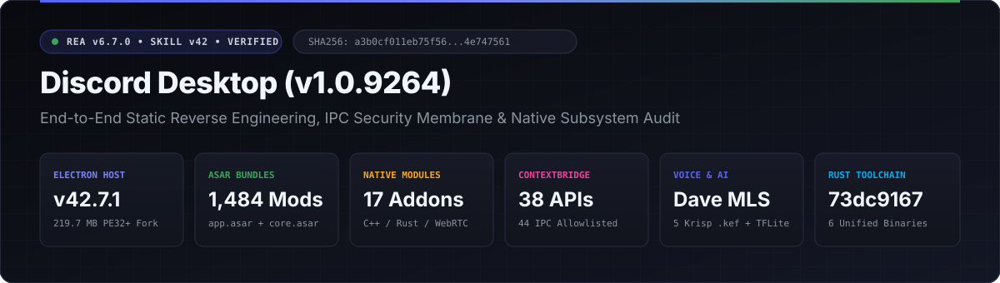
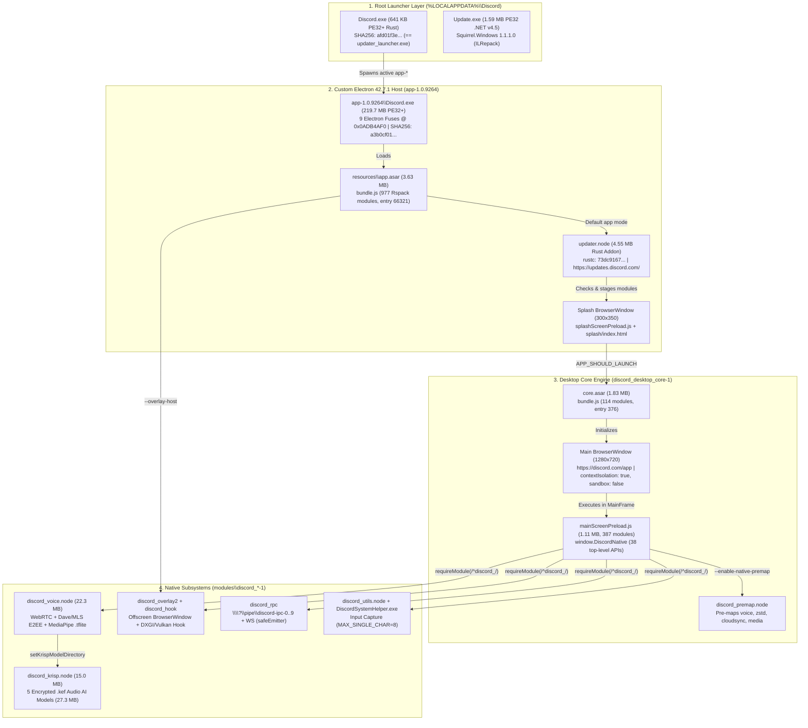
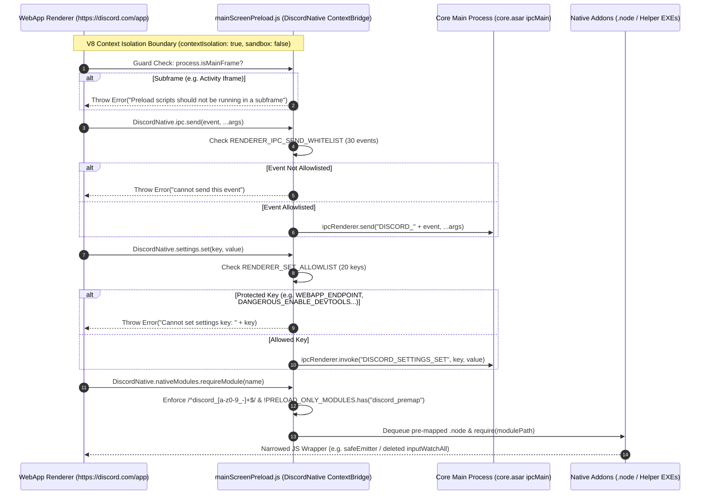
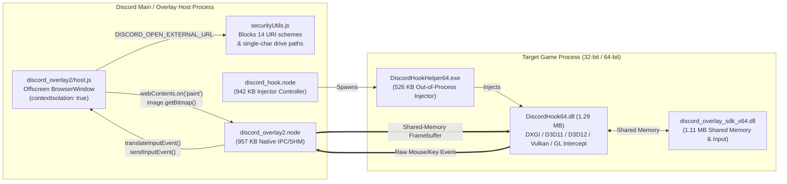
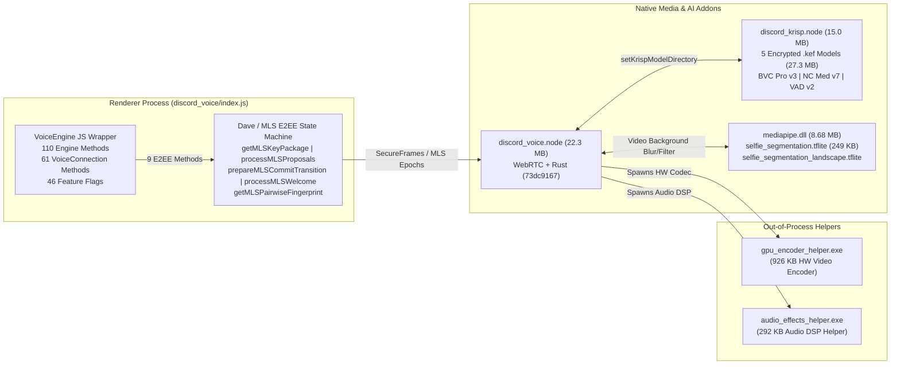

<div align="center">



<br />

-5865F2?style=flat-square&logo=discord&logoColor=white)
-47848F?style=flat-square&logo=electron&logoColor=white)
-3BA55C?style=flat-square)

-0078D6?style=flat-square&logo=windows&logoColor=white)


**Deterministic static, metadata, and security reverse-engineering of Discord Desktop for Windows (`app-1.0.9264`)**  
*Every architectural claim is backed by cryptographic SHA-256 digests and verifiable `rea-agents` v6.7.0 `evidence_id` records.*

[01 • Native & Packaging](./docs/01-native-and-packaging.md) · [02 • ASAR & Electron Core](./docs/02-asar-and-electron-core.md) · [03 • Native Subsystems (16 Modules)](./docs/03-subsystems-and-modules.md) · [04 • Security & IPC Surface](./docs/04-security-and-ipc-surface.md) · [Evidence Manifest (JSON)](./evidence/manifest.json)

</div>

---

## Where to Look (Repository Navigation)

| Document / Artifact | Scope & Key Contents | Primary REA Tools Used |
|---|---|---|
| **[`docs/01-native-and-packaging.md`](./docs/01-native-and-packaging.md)** | Electron Fuses (`0x0ADB4AF0`), PE resource trees (`RT_ICON`/`RT_VERSION`/`RT_MANIFEST`), `.NET v4.5` `Update.exe` (`ILRepack`), `XboxNetwork.winmd`, shared `rustc` commit `73dc9167...` | `inspect_electron_fuses`, `inspect_pe_resources`, `inspect_managed_artifact`, `inspect_managed_members`, `inspect_rust_binary` |
| **[`docs/02-asar-and-electron-core.md`](./docs/02-asar-and-electron-core.md)** | Bootstrapper (`resources/app.asar`, 977 Rspack modules), Core engine (`core.asar`, 114 modules), `mainScreenPreload.js` (`387` modules, 38 `DiscordNative` APIs), DNS telemetry | `analyze_javascript_application`, `inspect_analysis_view`, `trace_application_feature` |
| **[`docs/03-subsystems-and-modules.md`](./docs/03-subsystems-and-modules.md)** | All 16 native/JS subsystems (`discord_voice` Dave/MLS E2EE, `discord_krisp` 5 `.kef` models, `discord_overlay2`, `discord_hook`, `discord_rpc`, `discord_utils`, `discord_dispatch`, `discord_cloudsync`) | `analyze_javascript_application`, `inspect_analysis_view`, `inspect_pe_resources`, `inspect_rust_binary` |
| **[`docs/04-security-and-ipc-surface.md`](./docs/04-security-and-ipc-surface.md)** | 6-layer renderer security membrane, exact 30 `send` & 14 `invoke` IPC whitelists, 20 allowed `settings.set` keys, `0xd15c0d01` Crashpad code integrity stream, Ed25519 `staffDevTools` | `analyze_javascript_application`, `inspect_electron_fuses`, AST & bundle inspection |
| **[`evidence/manifest.json`](./evidence/manifest.json)** | Machine-readable JSON index of target SHA-256 digests, file byte lengths, `.NET` MVIDs, `rustc` hashes, and REA `evidence_id`s | Canonical REA Session Export |

---

## 1. End-to-End Architecture & Process Topology

### 1.1 Multi-Stage Boot & Module Handoff (`flowchart TD`)



---

### 1.2 Renderer ↔ Preload (`DiscordNative`) ↔ Main Process Security Membrane (`sequenceDiagram`)



---

### 1.3 In-Game Overlay (`discord_overlay2` + `discord_hook`) Framebuffer & Input Pipeline (`flowchart LR`)



---

### 1.4 Voice Engine (`discord_voice`), Dave/MLS E2EE & AI Media Pipeline (`flowchart LR`)



---

## 2. Key Technical Discoveries & Security Audit Highlights

### 2.1 Electron Fuses (`app-1.0.9264\Discord.exe` @ `0x0ADB4AF0`)
Inspected deterministically via `inspect_electron_fuses` (`ev_878d604fd2d9aeb4818d6f67c66e02bdf055c42b121c4b785906660d8170c639`):

| Fuse Index | Fuse Name | State | Raw Byte | Security Impact |
|---:|---|---|---|---|
| `0` | `RunAsNode` | **Disabled** (`false`) | `0x30` (`'0'`) | Blocks `ELECTRON_RUN_AS_NODE=1` living-off-the-land binary abuse |
| `1` | `EnableCookieEncryption` | **Disabled** (`false`) | `0x30` (`'0'`) | OS-level Chromium cookie encryption fuse disabled |
| `2` | `EnableNodeOptionsEnvironmentVariable` | **Enabled** (`true`) | `0x31` (`'1'`) | Honors `NODE_OPTIONS` environment variable from parent process |
| `3` | `EnableNodeCliInspectArguments` | **Disabled** (`false`) | `0x30` (`'0'`) | Ignores `--inspect` / `--inspect-brk` CLI debugging flags |
| `4` | `EnableEmbeddedAsarIntegrityValidation` | **Disabled** (`false`) | `0x30` (`'0'`) | Does not enforce build-time ASAR header integrity validation |
| `5` | `OnlyLoadAppFromAsar` | **Disabled** (`false`) | `0x30` (`'0'`) | Does not restrict app loading solely to `app.asar` |
| `6` | `LoadBrowserProcessSpecificV8Snapshot` | **Disabled** (`false`) | `0x30` (`'0'`) | Uses standard `v8_context_snapshot.bin` |
| `7` | `GrantFileProtocolExtraPrivileges` | **Enabled** (`true`) | `0x31` (`'1'`) | Grants `file://` privileges for local splash/overlay pages |
| `8` | `WasmTrapHandlers` | **Enabled** (`true`) | `0x31` (`'1'`) | Enables hardware out-of-bounds WebAssembly trap handling |

### 2.2 Notable Architectural & Security Mechanisms
1. **Custom Crashpad `0xd15c0d01` (`DISCORD_CODE_INTEGRITY`) Stream**:
   - Both `app.asar` (`55264`) and `core.asar/mainScreenPreload.js` (`278` + `5264`) parse a custom 76-byte Crashpad minidump stream (`0xd15c0d01`) that inspects executable pages (`MEM_COMMIT` + `PAGE_EXECUTE_ANY = 0xF0`) at crash time and tags Sentry reports with `code_integrity: "clean" | "modified"` and `code_integrity.distance: "near" | "within_page" | "distant"`.
   - Simultaneously, `app.asar` (`62457`) filters client mods via `ignoreErrors: ["BetterDiscord", "VencordPatcher", "mwittrien.github.io"]` and `denyUrls: [/betterdiscord:\/\//]`.
2. **Ed25519-Signed Staff DevTools Bundle (`core.asar` Module `4520`)**:
   - When `ENABLE_STAFF_DEV_TOOLS_BUNDLE` is set in `settings.json`, `staffDevTools.js` fetches `${WEBAPP_ENDPOINT}/__development/staff_dev_tools/module` and verifies an **Ed25519 signature** (`staff_dev_tools:v1:${version}:${hash}`) against hardcoded public key `MCowBQYDK2VwAyEAIoaTnSgNjloxqzHKGBXIp0F7JX3AaZKZCocqMBpSi/A=` before loading.
3. **Anti-Keylogging Mitigations in `discord_utils`**:
   - `discord_utils\index.js:90-91` wires `nativeUtils.inputWatchAll` into `input_capture.js` and immediately runs `delete nativeUtils.inputWatchAll;` before exporting `module.exports`.
   - `discord_utils\input_event.js:49-53` restricts global single-character A–Z keybinds (`scanCode 65..90` without modifiers) to `MAX_SINGLE_CHARACTER_BINDS = 8`, preventing a compromised renderer from binding all 26 letters as a background keylogger.
4. **Object-Capability Membrane in `discord_rpc`**:
   - `RPCIPC.js` (`\\?\pipe\discord-ipc-0..9`) and `RPCWebSocket.js` wrap all emitters in `null`-prototype `createSafeEmitter()` objects (`Object.create(null)`, `maxListeners = 10`, `fn.apply(null, args)`) and hide real `http.Server` / `ws.Server` instances inside a closure-private `origInstanceMap`.
5. **Out-of-Band Base32 DNS Failure Telemetry (`app.asar` Module `51937`)**:
   - When HTTPS requests to `discord.com/api/*` or `updates.discord.com/*` fail during startup, `app.asar` encodes connection diagnostics into base32 labels and resolves `<payload>.<uuid>.v1.dc-telemetry.net` via `dns.lookup`.
6. **PE `RT_GROUP_ICON` 16-Bit Truncation Quirk (`inspect_pe_resources`)**:
   - Both `app-1.0.9264\Discord.exe` (`ev_96ff7b5f...`) and `updater_launcher.exe` (`ev_271abcca...`) declare `declared_bytes: 8232` in `RT_GROUP_ICON` for their 256×256 icon (`RT_ICON` ID `4`), whereas the actual icon payload is `270,376` bytes (`270376 mod 65536 = 8232`, a 16-bit integer truncation in the resource bundler). `DiscordSystemHelper.exe` (`ev_a280ec26...`) declares the full `270,376` bytes (`size_matches: true`) for the identical icon SHA-256 (`8236fa18...`).

---

## 3. Complete 17-Module Subsystem Inventory (`app-1.0.9264\modules`)

| # | Module | Primary Artifact(s) | Size | Tech Stack | Role & Key Exports |
|---:|---|---|---:|---|---|
| 1 | `discord_desktop_core-1` | `core.asar` | 1.83 MB | Rspack JS (`114` + `387` mods) | Main window (`mainScreen.js`), `DiscordNative` preload (`mainScreenPreload.js`), `disclip://`, `frameView` |
| 2 | `discord_voice-1` | `discord_voice.node`<br>`mediapipe.dll`<br>`gpu_encoder_helper.exe`<br>`audio_effects_helper.exe` | 22.33 MB<br>8.68 MB<br>926 KB<br>292 KB | C++ / WebRTC / Rust (`73dc9167`) / TFLite | Voice/video engine, **Dave/MLS E2EE** (9 methods), GoLive screen share, MediaPipe selfie segmentation (`.tflite`) |
| 3 | `discord_krisp-1` | `discord_krisp.node`<br>5 × `.kef` model files | 15.07 MB<br>27.31 MB | C++ / Krisp AI | AI noise cancellation (`nc-o-med-v7`, `lite-v1`, `nb-v2`), Background Voice Cancellation (`bvc-o-pro-v3`), VAD (`vad-o-v2`) |
| 4 | `discord_dispatch-1` | `discord_dispatch.node` | 10.49 MB | Rust (`73dc9167`) | Game branch content downloader, delta patcher (`DispatchNative`) |
| 5 | `discord_cloudsync-1` | `discord_cloudsync.node` | 4.43 MB | Rust (`73dc9167`) | Cloud save synchronization (`/applications/:id/branches/:id/storage`) |
| 6 | `discord_modules-1` | `discord_modules.node`<br>`discord_aegis_x64.dll`<br>`discord_game_sdk_x64.dll` | 520 KB<br>492 KB<br>3.78 MB | C++ | Discord Game SDK v2 (x86/x64) and Discord Aegis (`discord_aegis_x64.dll` / `x86.dll`) |
| 7 | `discord_utils-1` | `discord_utils.node`<br>`DiscordSystemHelper.exe`<br>`notificationstate.node` | 2.13 MB<br>2.25 MB<br>141 KB | C++ | Global keybinds (`MAX_SINGLE_CHARACTER_BINDS = 8`), live minidumps, GPU driver queries (`nvidia-smi.exe`), system helper |
| 8 | `discord_hook-1` | `discord_hook.node`<br>`DiscordHook64.dll`<br>`DiscordHookHelper64.exe`<br>`discord_overlay_sdk_x64.dll` | 943 KB<br>1.29 MB<br>526 KB<br>1.11 MB | C++ | Graphics API hooking (DXGI/D3D/Vulkan/OpenGL), shared-memory framebuffer & input interception |
| 9 | `discord_overlay2-1` | `discord_overlay2.node`<br>`overlayPreload.js`<br>`overlayHost.js` | 958 KB<br>1.12 MB<br>226 KB | C++ / Webpack JS (`436` mods) | Offscreen overlay `BrowserWindow`, shared-memory bitmap sender, `securityUtils.js` URL filter |
| 10 | `discord_game_utils-1` | `discord_game_utils.node` | 1.02 MB | C++ | Running game process detection and execution utilities |
| 11 | `discord_desktop_overlay-1` | `discord_desktop_overlay.node` | 901 KB | C++ | Out-of-process HWND overlay window tracking & shared texture focus management |
| 12 | `discord_zstd-1` | `discord_zstd.node` | 740 KB | C++ / zstd | Streaming zstd decompression (`DecompressStream`) for Discord Gateway traffic |
| 13 | `discord_media-1` | `discord_media.node` | 720 KB | C++ | System analytics blob, memory usage blob, GPU stats (`getGpuStats`), clip montage rendering |
| 14 | `discord_erlpack-1` | `discord_erlpack.node` | 566 KB | C++ | Erlang External Term Format (`ETF`) binary serializer/deserializer (`pack`, `unpack`) |
| 15 | `discord_spellcheck-1` | `cld.node` | — | C++ (CLD) | Chromium Compact Language Detector binding |
| 16 | `discord_notifications-1` | `notifications_win.js` | 8 KB | JS (`ToastGeneric`) | Windows Toast XML builder (`escapeXml`) & Electron `Notification` bridge |
| 17 | `discord_rpc-1` | `RPCIPC.js`, `RPCWebSocket.js`, `safeEmitter.js` | 8 KB | JS (`net`, `http`, `ws`) | Local RPC server over `\\?\pipe\discord-ipc-0..9` and WebSocket with `safeEmitter` isolation |

---

## 4. Master REA Cryptographic Evidence Ledger

| Target Artifact | REA Tool | Primary `evidence_id` | Artifact SHA-256 |
|---|---|---|---|
| `app-1.0.9264\Discord.exe` (Fuses) | `inspect_electron_fuses` | `ev_878d604fd2d9aeb4818d6f67c66e02bdf055c42b121c4b785906660d8170c639` | `a3b0cf011eb75f568963fd0942648455e125b030b4b578fec652dc0b4e747561` |
| `app-1.0.9264\Discord.exe` (PE Resources) | `inspect_pe_resources` | `ev_96ff7b5fb863762aa1a1f393e5cfed84813af65023b03ad1216bdeb63a1bb754` | `a3b0cf011eb75f568963fd0942648455e125b030b4b578fec652dc0b4e747561` |
| Root `Discord.exe` / `updater_launcher.exe` | `inspect_pe_resources`<br>`inspect_rust_binary` | `ev_5bda2e07a993d75ec70b091ce2b5f467374ff3e7f52948bb26647720d56ed316`<br>`ev_bf8ebcb459d16df51e2cbb604836d38b98a0b6a7448d91e5e15faa0d311e94b3` | `afd01f3e2bb55540f9f5871fbcc24df22e329fd7101a1798bc1905af490e5b55` |
| `Update.exe` (`.NET v4.5` Squirrel) | `inspect_managed_artifact`<br>`inspect_managed_members` | `ev_b941cbdc137bd89c4dd6b89da1282e1da44c8f40fa250e92b02d1f27f49e66c2`<br>`ev_296a557bc49ff371acda24705c720a9672c22882c719a9a0007ab903e05275bc` | `0a166a5da46cce77637fdab36b18f09dbc3b24fc839dbc451bb8a862a09fbab8` |
| `XboxNetwork.winmd` (`WinRT 1.4`) | `inspect_managed_artifact`<br>`inspect_managed_members` | `ev_23ab07860b9e0d2b23ecb9e1907229556259c21b84c4402cbfa0abc2045ee008`<br>`ev_c070a4db183edb207b98fb133e34d9e48ccef73f9d9c5fb0859316caeb8e2336` | `dd76201ed745fb7231dc48eb644c2b9c0dc424cdff97b0ed001777ba8a2707fb` |
| `updater.node` | `inspect_rust_binary` | `ev_051ca978d1d97c0d125d3d358790d8efc19987a07c641d4b550141c22380e130` | `c25eca24e0b53f591608c12f7bcb04bc14c5f6099547fb88316567d01527a196` |
| `discord_dispatch.node` | `inspect_rust_binary` | `ev_9b868fa2c3c9a4a41e2a2da7d124f6eef0c79f9fdb61d7e355cc4c0fbdacf989` | `24eb096355fb6e68ede690918685da96d725077471bb4e837e7769a4c8e3e0f6` |
| `discord_cloudsync.node` | `inspect_rust_binary` | `ev_11579ad2fb67d585a619722145c0e788efd32146a2c61d4baad4c4c90b3daa4c` | `e7337463cffd621b23ca14d19b9075d5c3599ceb66f3a8a508b0967019c285d4` |
| `resources\app.asar` | `analyze_javascript_application` | `ev_406bd84efa4a93bc450cc6929a464e4a919e19cd9280740923522633c33d565d` | `0025c02c7241045a12464309604ec4d5b8ec7ed2ce43cce05d5dacb8f253f672` |
| `discord_desktop_core\core.asar` | `analyze_javascript_application`<br>`trace_application_feature` | `ev_a1cebcf9a45b93e46a93385597d537ff5a8a952df9fa9ce69069fb22bd4f5211`<br>`ev_6114a862c57c0317b7f43758925a8d631451ccba43de4788ac05f2fe3fca89c6` | `922c22e53eceb3a62fdfa51240ebbbb55e8e75cbc03caa6b711f6193448fa48e` |
| `discord_overlay2` | `analyze_javascript_application` | `ev_09baabba5fdf2c4eccacfb187cef46a1165885ce273d8242bb5eb61cc97afc06` | `a391cb775ef96695d6d798214a023737d15c3870e3f1766c2646508f48b197ac` |
| `discord_rpc` | `analyze_javascript_application` | `ev_e61d4dee924047b3e8551e71f654098637aef3392816d13100ccacc5951d02ca` | `fd2ec69747a3d41324571e942c5baf57f4583cf469b94d665fd9e2a4999bed2a` |
| `discord_utils` | `analyze_javascript_application` | `ev_ce53d51eafbde33ecb1f5d782338b9e5c74ce5f2f7d69b213c679258a36706a1` | `5cb163fb4fb15c08f11d01228125c73b64353ae2b0c2120fb47f91a21804031c` |
| `discord_voice` | `analyze_javascript_application`<br>`inspect_rust_binary` | `ev_243d9bc436d7aa8849989fc3fbfe7d813f6e33b7049fd40ce1ff5d3acea1fd22`<br>`ev_f7e86db7171003202ebf907977ce27d174b92d4df1ac3f6717ea3a012cc8d203` | `34533394b388193299e98db27ac81981a3399ec5fb6acc6d6c89670e317ba086` |

---

## 5. Reproducibility Runbook (`rea-agents@6.7.0`)

Reproduce any Evidence record deterministically using the `rea-agents` CLI or MCP server:

```powershell
# 1. Inspect Electron Fuses on Discord.exe
npx -y rea-agents@6.7.0 inspect-electron-fuses "$env:LOCALAPPDATA\Discord\app-1.0.9264\Discord.exe" --json

# 2. Inspect PE Resources & Icon Groups
npx -y rea-agents@6.7.0 inspect-pe-resources "$env:LOCALAPPDATA\Discord\app-1.0.9264\Discord.exe" --json

# 3. Inspect .NET / CLI Metadata in Squirrel Update.exe & WinMD
npx -y rea-agents@6.7.0 inspect-managed-artifact "$env:LOCALAPPDATA\Discord\Update.exe" --detail summary --json
npx -y rea-agents@6.7.0 inspect-managed-members "$env:LOCALAPPDATA\Discord\app-1.0.9264\Microsoft.Gaming.XboxApp.XboxNetwork.winmd" --detail summary --json

# 4. Inspect Rust Toolchain Provenance Across Native Addons
npx -y rea-agents@6.7.0 inspect-rust-binary "$env:LOCALAPPDATA\Discord\app-1.0.9264\updater.node" --json
npx -y rea-agents@6.7.0 inspect-rust-binary "$env:LOCALAPPDATA\Discord\app-1.0.9264\modules\discord_voice-1\discord_voice\discord_voice.node" --json

# 5. Analyze Bootstrapper (app.asar) & Core Engine (core.asar)
npx -y rea-agents@6.7.0 analyze-javascript-application "$env:LOCALAPPDATA\Discord\app-1.0.9264\resources\app.asar" --detail summary --json
npx -y rea-agents@6.7.0 analyze-javascript-application "$env:LOCALAPPDATA\Discord\app-1.0.9264\modules\discord_desktop_core-1\discord_desktop_core\core.asar" --detail summary --json
```
